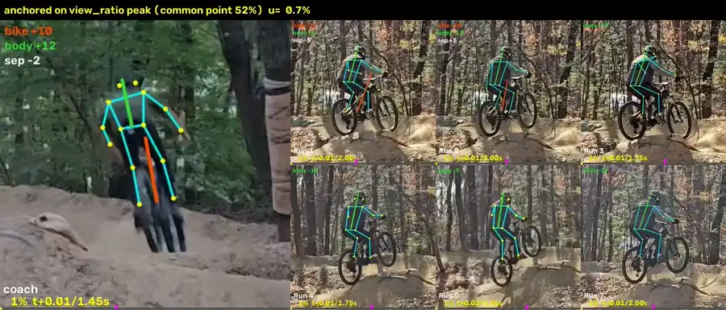
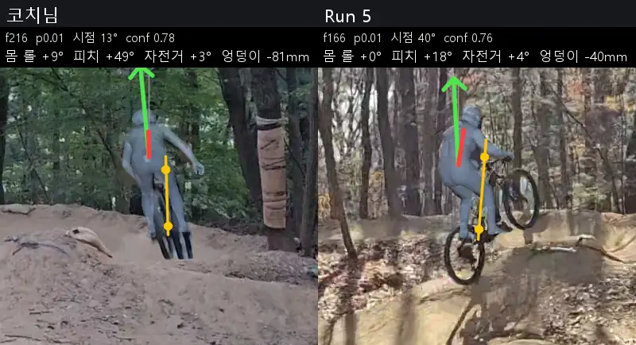
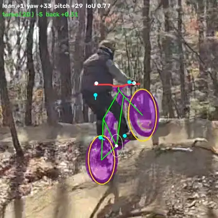
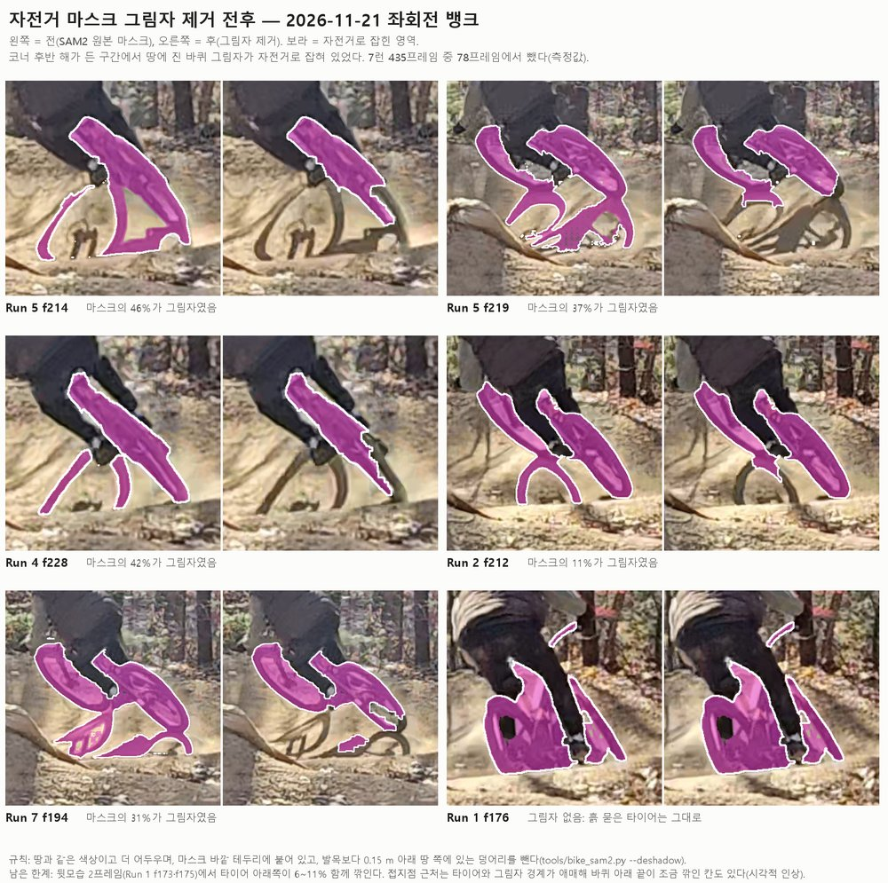
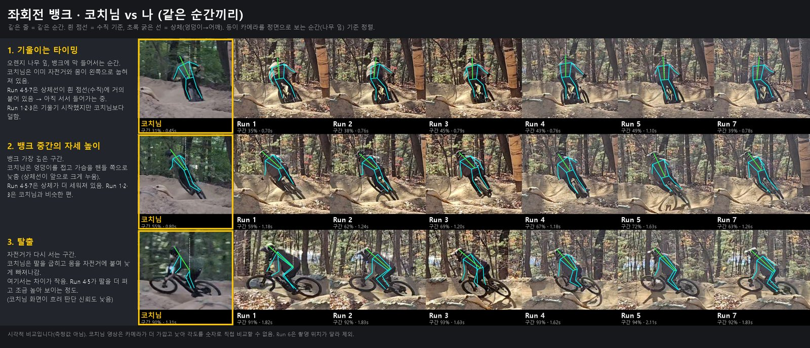
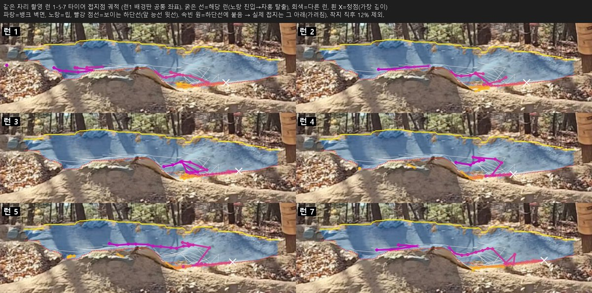
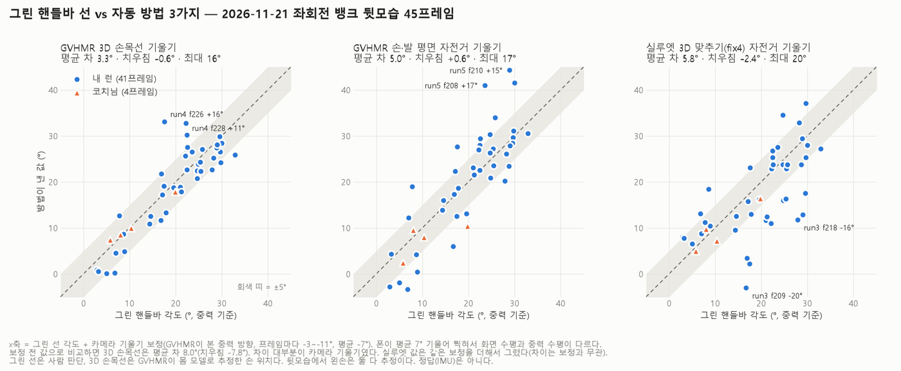

# ai-mtb-coach

MTB 강습 영상을 분석해 라이더 자세, 자전거 기울기, 뱅크 위 라인을 인식하고 코치의 모범 주행과 비교하는 에이전트형 분석 도구.

매주 강습이 끝나면 코치가 스마트폰 등으로 찍은 주행 영상과 짧은 텍스트 피드백을 보내 준다. 피드백이 "좌회전 뱅크 자세와 라인이 불안정하다"여도 영상만 봐서는 무엇이 다른지 알기 어렵다. 이 저장소는 그 차이를 장면별 비교 이미지와 수치로 보여 주려고 만들었다.



*코치(왼쪽 큰 칸)와 내 런 6개를 같은 기준점에 맞췄다. 기준점은 등이 카메라를 정면으로 보는 순간이다. 주황 = 발→손(자전거 근사), 초록 = 상체. `bike`·`body`·`sep` 숫자는 2D 측정값이다.*

## 무엇을 보여 주나 (2026-11-21 강습 예시)



*3D 몸 자세(GVHMR). 영상에서 3D 몸 메시를 복원한다. 상체 롤·피치는 중력 방향(초록 화살표)을 기준으로 잰다. 그래서 카메라 시점이 바뀌어도 각도가 흔들리지 않는다. 코치와 Run 5를 같은 진행률로 맞췄다.*

| 3D 자전거 맞추기 | 그림자 제거 전후 |
|---|---|
|  |  |
| 자전거 마스크(보라)에 3D 모델(초록·노랑)을 맞춘다. 3D 모델은 자전거 지오메트리로 만들었다. 결과로 기울기와 방향(yaw)이 나온다. 옆모습에서는 잘 맞는다. 사람이 그린 핸들바 선 41프레임(대부분 뒷모습)과 비교하면 평균 7~8° 차이가 난다(측정값). | 해가 든 코너 출구에서 SAM2 자전거 마스크가 땅에 진 바퀴 그림자까지 감쌌다. 그림자 판정 조건은 세 가지다. 땅과 색상이 같아야 한다. 땅보다 어두워야 한다. 발목보다 아래에 있어야 한다. Run 5 f214는 마스크의 46％가 그림자였다(측정값). |



*같은 순간끼리 놓은 비교 보드다. 코치는 뱅크에 들어서기 전에 이미 자전거와 몸을 기울였다. Run 4·5·7은 같은 순간에 상체가 거의 수직이다(시각적 인상).*

| 뱅크 라인 지도 | 사람이 그린 핸들바 선으로 채점 |
|---|---|
|  |  |
| 패닝 영상을 배경판 하나로 합쳤다. 뱅크 벽면(파랑) 위에 타이어 접지 궤적(분홍)을 그렸다. 런마다 라인 높이와 정점이 다르다(측정값). | 사용자가 핸들바 선 45프레임을 직접 그렸다. 이 선을 기준으로 자동 방법 세 가지를 채점했다. GVHMR 손목선이 평균 3.3°로 가장 가깝다(측정값). |

## 에이전트 구조

결과가 결정론적인 파이프라인 하나로 나오지 않는다. 스마트폰 등으로 손에 들고 찍은 흔들리는 영상, 가림, 그림자, 시점 변화 때문에 각 단계의 결과를 사람이나 LLM이 직접 보고 판단해야 한다. 그래서 코딩 에이전트(Claude Code)가 다음처럼 일한다.

- **코디네이터:** 사용자와 대화하며 다음에 무엇을 할지 정하고, 오래 걸리는 작업은 백그라운드 에이전트에게 맡긴다.
- **작업 에이전트:** `tools/`의 비전 도구를 고치고 돌린다. 결과 몽타주를 직접 보고 실패 프레임을 보고한다.
- **검증:** 코디네이터가 산출 이미지를 다시 확인한 뒤에만 인사이트로 쓴다. 틀린 결론은 [LOG.md](LOG.md)에 정정으로 남긴다.
- **인사이트는 시각 자료와 함께:** 모든 결론에 근거 장면 보드를 붙이고, 측정값인지 시각적 인상인지 표시한다.

에이전트가 따르는 규칙은 [AGENTS.md](AGENTS.md)에 있다.

## 파이프라인

| 단계 | 도구 | 하는 일 |
|---|---|---|
| 1 | `compare_runs.py` | 같은 구간을 여러 번 탄 런을 진행률로 맞춘 프레임 시트·동기화 영상 |
| 2 | `analyze_pose.py` | YOLO11 pose + ByteTrack으로 라이더 추적, 라이더 중심 크롭 |
| 3 | `analyze_lean.py` | 크롭 재추론으로 상체 기울기·관절각·시점 지표(view_ratio) |
| 4 | `bike_sam2.py` | SAM2 비디오 추적으로 자전거 마스크 (포즈 키포인트 프롬프트 지원) |
| 5 | `bike_fit.py` | 자전거 지오메트리로 만든 3D 모델을 마스크에 맞춰 자전거 기울기·yaw 추정 |
| 6 | `compare_reference.py` | 코치 영상과 내 런을 시점 기준점으로 정렬한 비교 영상 |
| 7 | `berm_line.py` | 패닝 영상을 배경판으로 합성, 뱅크 벽면 분할, 타이어 접지 궤적과 높이 |
| 8 | `insight_board.py`, `separation_board.py` | 장면별 비교 보드, 자전거 vs 상체 기울기 보드 |
| 9 | `body3d_gvhmr.py` | GVHMR(WSL2)로 중력 기준 3D 몸 자세를 복원해 시점에 무관한 상체 롤·피치, 손·발 기준 자전거 평면을 잼 |
| 10 | `body3d_sam3d.py` | SAM 3D Body로 3D 몸 각도를 한 번 더 잼(GVHMR과 교차 확인) |
| 11 | `bar_hint_board.py` | 사용자가 핸들바 선을 그릴 보드를 만들고, 그린 선을 읽어 채점 기준·`bike_fit.py` 힌트로 씀 |
| 12 | `body_com.py` | GVHMR 관절과 체절 질량 비율로 몸 전체 무게중심을 계산. 무게선 기울기, 자전거 면에서 떨어진 거리, 뒤에서 본 골격 그림 |

## 폴더 구조

```
tools/                  분석 도구 (paths.py = 경로 규칙)
sessions/<세션>/         강습별 설정: segments.json(구간·자전거), 보드 spec, 뱅크 프롬프트  ← git 추적
sessions/rider.local.json  라이더 키·몸무게(무게중심 cm 값용)                                ← git 제외
reference/<세션>/        원본 영상                                                      ← git 제외
outputs/<세션>/          모든 산출물(크롭·마스크·CSV·보드·영상)                              ← git 제외
docs/                   촬영 요청 목록, 외부 도구 조사
LOG.md                  작업 로그(시도·결과·판단·정정)
```

원본 영상과 산출물에는 라이더와 코치의 모습이 들어 있어 저장소에 넣지 않는다. 도구를 다시 돌리면 `outputs/`가 만들어진다. README 이미지(`docs/media/`)만 라이더 본인과 코치의 동의를 받아 올렸다.

## 실행

요구 사항: NVIDIA GPU(RTX 4090에서 개발), [uv](https://docs.astral.sh/uv/), ffmpeg. Windows에서 개발했고 한글 표시에 맑은 고딕 폰트를 쓴다.

```bash
uv sync
# 새 세션: 영상을 reference/<세션>/에 넣고 sessions/<세션>/segments.json 작성
uv run python tools/analyze_pose.py sessions/<세션>/segments.json
uv run python tools/analyze_lean.py sessions/<세션>/segments.json
PYTHONPATH=tools uv run python tools/bike_sam2.py sessions/<세션>/segments.json
uv run python tools/bike_fit.py sessions/<세션>/segments.json
```

모델 가중치(YOLO11x pose/seg, SAM2.1-b)는 Ultralytics가 처음 실행할 때 `models/`로 내려받는다. 각 도구의 사용법은 파일 맨 위 docstring에 있다.

`segments.json` 예시는 [sessions/2026-11-21/segments.json](sessions/2026-11-21/segments.json)에 있다. 자전거 지오메트리는 `"bike"` 항목으로 지정한다.

## 한계

- 스마트폰 등 카메라 한 대로 찍은 2D 영상이라 기울기 값에 시점 영향이 섞인다. 뒷모습 구간의 자전거 기울기는 프레임당 ±10° 정도로 본다.
- 뱅크 벽 높이는 카메라 위치에 따라 바퀴가 가려져 잴 수 없는 구간이 있다.
- 뱅크 위 거리는 실제 단위(cm)가 없어 같은 촬영 자리의 런끼리만 비교한다. 몸 관련 cm 값(무게중심)은 라이더 키로 크기를 맞춘 값이다.
- 무게중심은 체절 질량 비율로 계산한 값이라 정답 데이터로 검증하지 못했다. 뒷모습에서는 앞뒤 위치가 카메라 깊이 방향이라 보지 않는다.

더 정확한 분석에 필요한 촬영 자료는 [docs/capture-requests.md](docs/capture-requests.md)에 정리했다.

## 라이선스

코드와 문서는 [MIT 라이선스](LICENSE)를 따른다. 단, `docs/media/`의 이미지는 이 라이선스에 포함하지 않는다. 라이더 본인과 코치의 모습이 담겨 있고, 이 저장소의 README에서만 쓰도록 동의를 받았다. 다른 곳에서 다시 쓰지 않는다.
